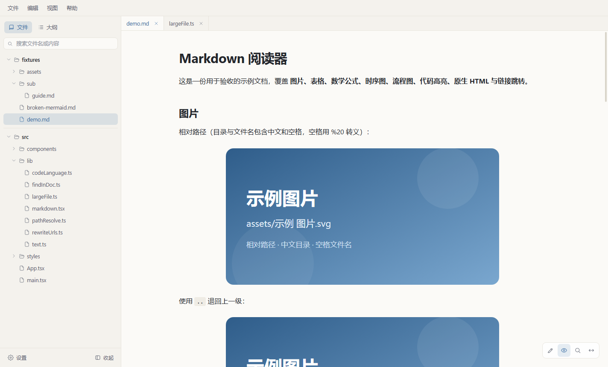
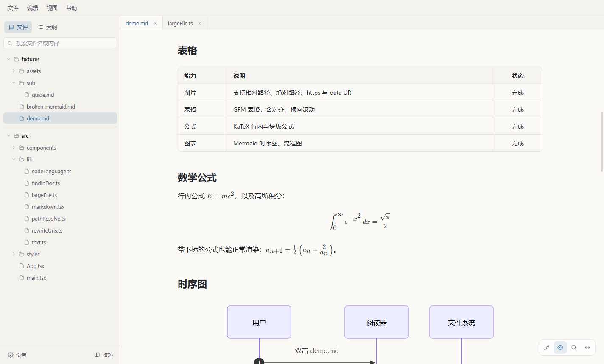
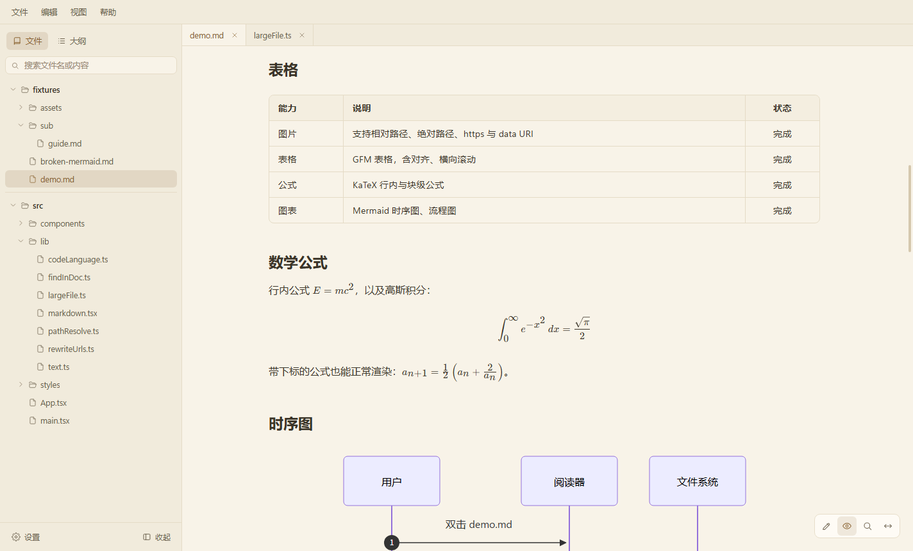
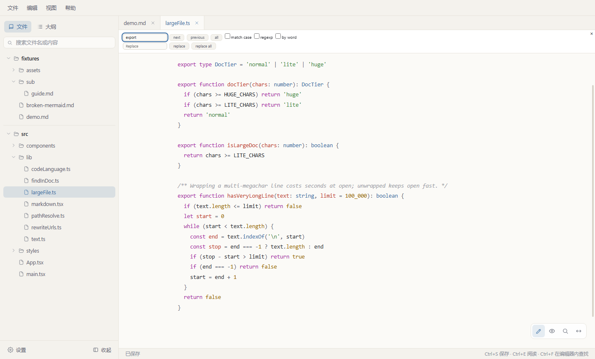

# Markdown Viewer

> 专注阅读体验的 Windows 本地 Markdown / 文本 / 代码阅读器。
> A local, keyboard-friendly Markdown and code viewer for Windows.

[](#)
[](https://www.electronjs.org/)
[](LICENSE)

Markdown Viewer 是一个本地优先的桌面阅读器：没有账号、没有云端、没有遥测。打开文件或文件夹即可阅读 Markdown、纯文本和常见代码文件，也可以直接编辑保存。界面为阅读而设计，支持完整 Markdown 渲染、多标签、文件树、全文搜索和 Windows 文件关联。



## 功能

- **专注阅读**：窄内容栏、可调正文宽度与行距、四档主题（跟随系统 / 浅色 / 深色 / 护眼米色），滚动时大纲同步高亮。
- **完整 Markdown**：GFM 表格与任务列表、KaTeX 数学公式、Mermaid 时序图/流程图、代码高亮、目录锚点、相对链接跳转，以及经过净化的原生 HTML。
- **本地图片**：支持相对路径、绝对路径、`https` 与 `data:` URI；中文目录、空格文件名均可解析。
- **多文档工作区**：多根文件树、标签页、会话恢复、最近打开，支持拖拽、命令行参数和第二次启动继续打开文件。
- **阅读与编辑**：Markdown 可在预览与源码之间切换；文本和代码文件使用 CodeMirror 6 高亮编辑。保存前检测外部修改，冲突时给出横幅选择。
- **查找**：Markdown 预览内查找、编辑器内查找；文件树同时支持文件名与文件内容搜索。
- **文件管理**：新建文件/文件夹、在资源管理器中定位、删除到回收站、右键菜单操作。
- **大文件优化**：按字符数自动切换精简模式，避免超大文件在后台被完整解析，10 MB 级纯文本也能快速打开和平滑滚动。
- **Windows 集成**：注册/修复 `.md` 与 `.markdown` 文件关联，关闭窗口后驻留托盘，单实例运行。
- **本地与安全**：无账号、无遥测；启用 `contextIsolation` 与渲染进程沙箱，Markdown 中的 HTML 会被净化，外链交由系统浏览器打开。

## 截图

| 表格、公式与 Mermaid | 深色主题 |
|:---:|:---:|
|  |  |

| 护眼米色 | 代码编辑与查找 |
|:---:|:---:|
|  |  |


## 支持的格式

| 类型 | 扩展名 / 文件名 | 行为 |
| --- | --- | --- |
| Markdown | `.md` `.markdown` | 预览 + 源码编辑 |
| 文本 / 代码 | 见下方说明 | 高亮显示 + 编辑保存 |

代码与文本采用白名单识别，覆盖 JavaScript / TypeScript / JSX / TSX、JSON、HTML、CSS / SCSS / LESS、Python、Java、C / C++、C#、Go、Rust、PHP、Ruby、Perl、Lua、R、Swift、Kotlin、Scala、Dart、Objective-C、Shell、PowerShell、Batch、SQL、YAML、TOML、INI / Properties、`.env`、TeX、GraphQL、Vue / Svelte / Astro、Diff / Patch、日志、CSV / TSV、`Dockerfile`、`Makefile`、`LICENSE`、`README` 等。完整列表见 [`src/shared/fileKinds.ts`](src/shared/fileKinds.ts) 与 [`src/renderer/src/lib/codeLanguage.ts`](src/renderer/src/lib/codeLanguage.ts)。

单个文件读取与保存上限为 **30 MB**。

## 大文件处理

大文件模式使用文档的 UTF-16 字符数分级，而不是磁盘字节数，因为后者与渲染成本并不完全对应：

| 字符数 | 模式 | 行为 |
| --- | --- | --- |
| `< 2,000,000` | 普通 | 正常高亮、自动换行与 Markdown 预览 |
| `>= 2,000,000` | 精简 | 关闭语法高亮与额外编辑特性；Markdown 直接以源码打开；仍可编辑保存 |
| `>= 20,000,000` | 超大 | 默认只读，`Ctrl+E` 或状态栏按钮确认后才允许编辑 |

实现要点：

- 非 Markdown 文件、大 Markdown 源码模式不再挂载隐藏的 Markdown 预览，避免在后台完整执行 remark / rehype 解析。
- 编辑器基于 CodeMirror 6 的 rope 文档与视口渲染，DOM 只保留可见区域附近的行。
- 单行超长文本会自动关闭自动换行，避免在打开时进行代价极高的换行高度计算。
- 不做文件分段加载，保持编辑、搜索、保存与外部修改检测使用同一份文档状态。

## 快捷键

| 快捷键 | 功能 |
| --- | --- |
| `Ctrl+O` | 打开文件 |
| `Ctrl+Shift+O` | 打开文件夹 |
| `Ctrl+S` | 保存 |
| `Ctrl+E` | 切换阅读 / 编辑 |
| `Ctrl+F` | 查找（预览内或编辑器内） |
| `Ctrl+B` | 显示 / 隐藏侧栏 |
| `Ctrl+W` | 关闭当前标签页 |
| `Ctrl+Tab` / `Ctrl+Shift+Tab` | 切换标签页 |
| `Ctrl+,` | 打开设置 |
| `F5` | 重新加载当前文档 |
| `Esc` | 关闭设置、查找或对话框 |

## 安装与使用

从 Releases 下载 Windows x64 压缩包，解压后直接运行 `md-viewer.exe`，无需安装。

也可以把文件或文件夹拖入窗口，或通过命令行打开：

```bash
md-viewer.exe "D:\notes\README.md"
md-viewer.exe "D:\notes"
```

首次使用 `.md` 文件关联时，在「设置 → 文件关联」中点击「注册关联」。Windows 10/11 不允许程序静默成为默认应用，若仍被其他编辑器接管，请在系统「默认应用」中为 `.md` 选择 Markdown Viewer，只需设置一次。

## 开发

需要 Node.js `^20.19.0` 或 `>=22.12.0`（推荐 Node 22 LTS 以上），Windows 环境。

```bash
npm install
npm run dev      # 启动开发模式
npm run build    # 类型检查并构建到 out/
npm run pack     # 构建并用 electron-builder 生成 release/win-unpacked
npm run zip      # 将 release/win-unpacked 压缩为 zip
```

目录结构：

```text
src/
  main/       Electron 主进程：窗口、IPC、文件监听、搜索、注册表协议
  preload/    受限的 window.mdv API
  renderer/   React 界面、CodeMirror 编辑器、Markdown 渲染管线
  shared/     主进程与渲染进程共享的类型和白名单
docs/
  screenshots/ README 截图
fixtures/     渲染能力验收用的示例文档
```

技术栈：Electron 45、electron-vite 6、React 19、TypeScript 7、CodeMirror 6、react-markdown、remark / rehype、KaTeX、Mermaid。

## 隐私

文档内容、编辑草稿和设置都只保存在本机。应用不包含账号系统、统计或遥测上报。只有在文档引用远程图片，或你主动点击外部链接时，才会访问网络。

## 参与贡献

欢迎提交 Issue 和 Pull Request。提交前请确保：

```bash
npm run build
```

类型检查与构建通过，并尽量在 `fixtures/demo.md` 上验证 Markdown 渲染、编辑保存和查找没有回归。

## 许可证

[MIT](LICENSE)
