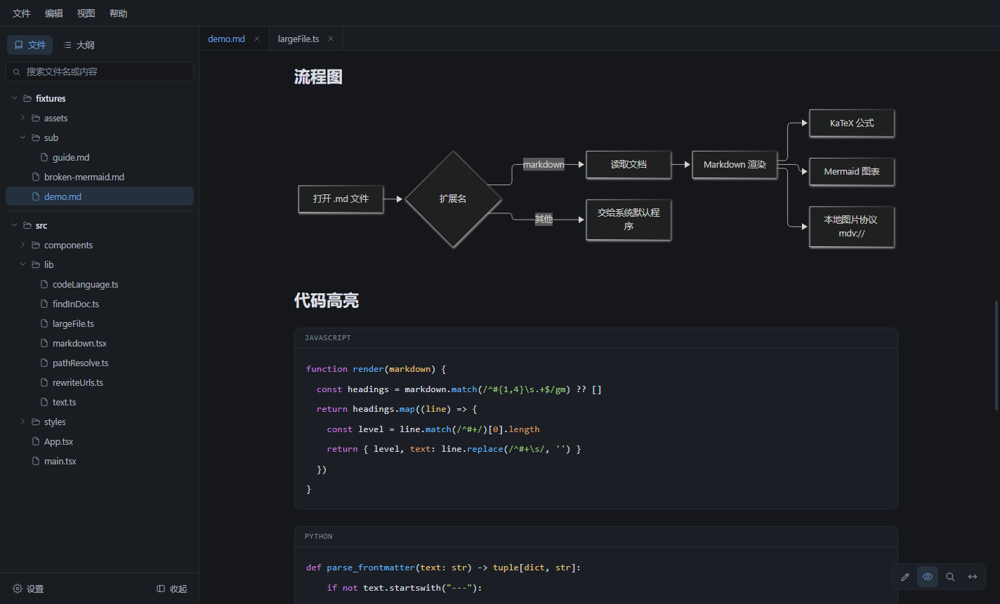
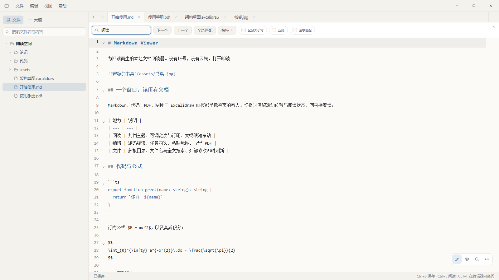
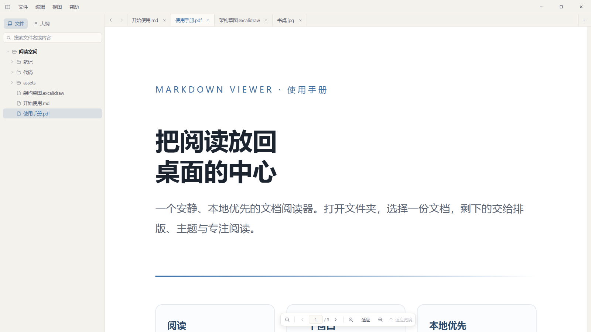
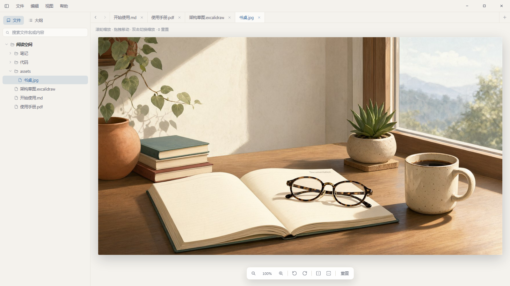
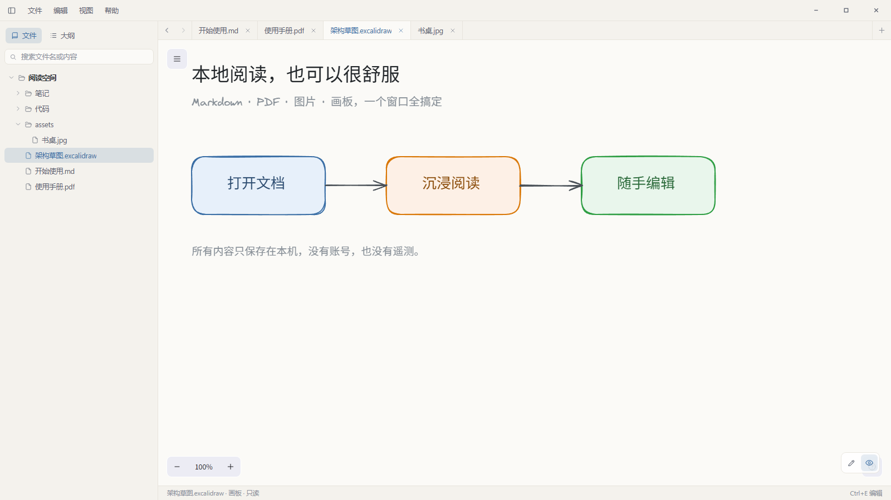

# Markdown Viewer

**一个安静、本地优先的 Windows 文档阅读器。**
Markdown、代码、PDF、图片、Excalidraw 画板与思维导图，一个窗口读完。

[](#)
[](https://www.electronjs.org/)
[](LICENSE)


打开文件夹，文档按目录排在左侧。没有账号，没有云端，也没有多余的按钮——你看到的，就是文档本身。

## 为什么是它

- **打开即读**：常用文档格式都是标签页的客人，不用为每种文件装一个阅读器。
- **读得舒服**：窄内容栏、大留白，宽度、字号、行距与配色都能调，大纲跟着滚动走。
- **需要时能改**：阅读与源码一键切换，任务复选框可以直接勾选，截图粘贴即插入。
- **回来接着读**：滚动位置、PDF 页码、图片缩放都按文件记住，关掉再开也能接上。

## 界面

| 深色主题 | 阅读与源码编辑 |
|:---:|:---:|
|  |  |

| PDF 阅读 | 图片查看 |
|:---:|:---:|
|  |  |

| Excalidraw 画板 | 设置 |
|:---:|:---:|
|  |  |

## 功能

- **Markdown 渲染**：GFM 表格与任务列表、代码高亮、KaTeX 公式、Mermaid 流程图、目录锚点与相对链接；原生 HTML 经过净化。
- **阅读排版**：正文宽度、字号、行距与字体可调；八套配色（另可跟随系统）同时作用于正文、代码、图表与窗口，深色下系统控件同步切换。
- **编辑与保存**：Markdown 可在预览与源码间切换，文本与代码使用 CodeMirror 6 编辑；编辑时默认左侧源码、右侧实时预览分屏显示，滚动双向同步、分隔条可拖拽，也可切回纯源码；内置格式工具栏，粗体、标题、列表、链接、表格、公式、脚注等一键插入正确语法，不熟悉语法也能排版；保存前检测外部修改，不会悄悄覆盖别人的改动。阅读模式下可直接勾选任务复选框，`Ctrl+S` 落盘。
- **粘贴图片**：编辑 Markdown 时粘贴截图或剪贴板图片，自动保存到设置的图片目录（默认文档旁 `assets/`）并在光标处插入链接。
- **文件工作区**：多根文件夹、多标签、会话恢复、最近打开；支持文件名与全文搜索、重命名、隐藏、删除到回收站，外部增删改会实时刷新。
- **PDF 阅读**：内置 pdf.js 离线渲染，可划选复制、文档内查找、翻页与缩放；读取书签大纲，切换标签后保留页码。
- **图片查看**：滚轮缩放、拖拽平移、双击切换、旋转与翻转；切换标签后保留缩放、旋转和位移。
- **禅模式**：在资源管理器中双击受支持的文件（Markdown、文本、代码、PDF、图片、脑图），直接进入无边框的专注阅读窗口；窗口按文件格式给出合适的默认尺寸并居中（不占满全屏），每个文件各开一个窗口，可同时打开多个，顶部标题栏提供最小化 / 最大化 / 关闭，`Esc` 或标题栏关闭按钮退出，也能一键回到主界面。
- **Excalidraw 画板**：新建、编辑、保存 `.excalidraw`；在 Markdown 中以 `` 或 `![[草图.excalidraw]]` 嵌入为静态 SVG，点击可弹层预览并一键进入编辑。
- **思维导图**：新建、编辑、保存 `.smm`；富文本节点、拖拽调整结构、七种布局切换，工具栏可插入子主题 / 同级主题、删除主题，并导出 PNG / SVG / XMind；支持直接打开 `.xmind` 文件（导入后保存为 `.smm`）。
- **导出 PDF**：`Ctrl+P` 将当前 Markdown 导出为 A4 PDF，配色跟随主题，包含公式、Mermaid 图表与画板，也会带上未保存的修改。
- **大文件**：按字符数自动进入精简或只读模式，10 MB 级文本也能快速打开和平滑滚动。
- **Windows 集成**：无边框自定义标题栏、`.md` 文件关联、单实例运行，关闭窗口后驻留托盘；双击文件即开禅模式窗口。
- **本地与安全**：无账号、无遥测；渲染进程沙箱与上下文隔离，外链交由系统浏览器打开。

## 支持的格式

| 类型 | 扩展名 / 文件名 | 行为 |
| --- | --- | --- |
| Markdown | `.md` `.markdown` | 预览 + 源码编辑 |
| 画板 | `.excalidraw` | 画板阅读 + 编辑保存 |
| 思维导图 | `.smm` `.xmind` | 脑图阅读 + 编辑保存（`.xmind` 导入后另存为 `.smm`），可导出 PNG / SVG / XMind |
| PDF | `.pdf` | 内置阅读，复制 / 查找 / 大纲，只读 |
| 图片 | `.png` `.jpg` `.jpeg` `.gif` `.webp` `.avif` `.bmp` `.ico` `.svg` | 标签页内缩放 / 旋转 / 翻转，只读 |
| 文本 / 代码 | 按白名单识别 | 高亮显示 + 编辑保存 |

代码与文本覆盖 JavaScript / TypeScript、JSON、HTML、CSS、Python、Java、Go、Rust、SQL、Shell、YAML、TOML、日志、CSV、Dockerfile、Makefile 等常见格式，完整列表见 [`src/shared/fileKinds.ts`](src/shared/fileKinds.ts)。

单个文件读取与保存上限 **30 MB**，PDF **300 MB**，图片 **80 MB**。

## 快捷键

| 快捷键 | 功能 |
| --- | --- |
| `Ctrl+O` | 打开文件 |
| `Ctrl+Shift+O` | 打开文件夹 |
| `Ctrl+S` | 保存 |
| `Ctrl+P` | 导出当前 Markdown 为 PDF |
| `Ctrl+E` | 切换阅读 / 编辑 |
| `Ctrl+Shift+E` | 编辑时显示 / 隐藏实时预览 |
| `Ctrl+F` | 查找（预览、编辑器或 PDF 内） |
| `Ctrl+A` | 全选（阅读视图选中文档，编辑视图选中源码） |
| `Ctrl+B` | 显示 / 隐藏侧栏 |
| `Ctrl+W` | 关闭当前标签页 |
| `Ctrl+Tab` / `Ctrl+Shift+Tab` | 切换标签页 |
| `Ctrl+Shift+T` | 打开文件列表弹窗，可按名称或路径搜索 |
| `Alt+←` / `Alt+→` | 返回 / 前进 |
| `Ctrl+,` | 打开设置 |
| `F2` | 重命名文件树中选中的项目 |
| `F5` | 重新加载当前文档 |
| `Alt+F4` | 退出应用 |
| `Esc` | 关闭设置、查找、图片弹层或对话框；禅模式中退出禅模式 |

禅模式窗口只读、无菜单与标签栏，顶部标题栏显示文件名并提供最小化 / 最大化 / 关闭，以及回到主界面的入口；`.xmind` 双击仍进主界面（需解析后另存）。

编辑模式内：`Ctrl+Z` / `Ctrl+Y` 撤销重做，`Tab` / `Shift+Tab` 缩进，`Ctrl+Shift+[` / `Ctrl+Shift+]` 折叠代码块，`Ctrl+D` 选中下一个相同文本，`Ctrl+Alt+G` 跳转到行。查找面板用 `Enter` / `Shift+Enter` 切换匹配；图片视图聚焦后可用 `+` / `-` 缩放、`0` 重置。

脑图编辑内：`Tab` 插入子主题，`Enter` 插入同级主题，`Shift+Tab` 插入父主题，`Del` / `Backspace` 删除主题，`F2` 编辑文字，`/` 展开或收起，`Ctrl+A` / `Ctrl+C` / `Ctrl+X` / `Ctrl+V` 选中、复制、剪切、粘贴主题，`Ctrl+Z` / `Ctrl+Y` 撤销重做，`Ctrl+L` 整理布局，`Ctrl+Enter` 根主题居中。

完整清单也会显示在「帮助 → 关于」对话框中。

## 安装与使用

从 Releases 下载 Windows x64 压缩包，解压后直接运行 `md-viewer.exe`，无需安装。

也可以把文件或文件夹拖入窗口，或通过命令行打开：

```bash
md-viewer.exe "D:\notes\README.md"
md-viewer.exe "D:\notes"
```

如需接管 `.md` 文件，在「设置 → 文件关联」中点击「注册关联」。Windows 10/11 不允许程序静默成为默认应用，若仍被其他编辑器接管，请在系统「默认应用」中为 `.md` 选择 Markdown Viewer，只需设置一次。

## 隐私

文档内容、编辑草稿和设置都只保存在本机。应用不包含账号系统、统计或遥测上报。只有在文档引用远程图片，或你主动点击外部链接时，才会访问网络。

## 开发

需要 Node.js `^20.19.0` 或 `>=22.12.0`（推荐 Node 22 LTS 以上），Windows 环境。

```bash
npm install
npm run dev      # 启动开发模式
npm run build    # 类型检查并构建到 out/
npm run pack     # 构建并生成 release/win-unpacked
npm run zip      # 压缩为 zip
```

技术栈：Electron 45、electron-vite 6、React 19、TypeScript 7、CodeMirror 6、react-markdown、remark / rehype、KaTeX、Mermaid、Excalidraw。

## 许可证

[MIT](LICENSE)

