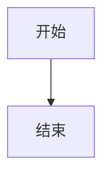

# 图表错误兜底

下面这个 Mermaid 图表语法有误，应显示为可读的错误框，且不影响其它内容。

```mermaid
sequenceDiagram
    participant A
    A->>B: 缺少参与者定义
    this is not valid mermaid
```

## 后续内容

错误框之后的标题、表格与公式都应正常工作。

| 列一 | 列二 |
| --- | --- |
| 1 | 2 |

行内公式 $a^2 + b^2 = c^2$ 正常。


