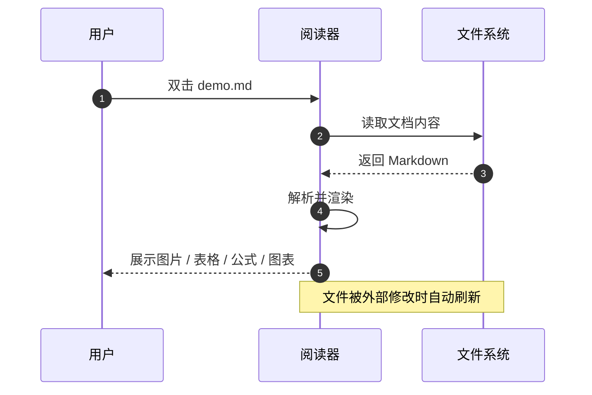
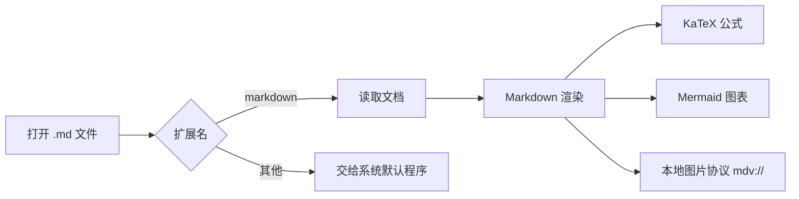

# Markdown 阅读器

这是一份用于验收的示例文档，覆盖 **图片、表格、数学公式、时序图、流程图、画板嵌入、代码高亮、原生 HTML 与链接跳转**。

## 图片

相对路径（目录与文件名包含中文和空格，空格用 %20 转义）：


使用 `..` 退回上一级：


## 表格

| 能力 | 说明 | 状态 |
| --- | --- | :---: |
| 图片 | 支持相对路径、绝对路径、https 与 data URI | 完成 |
| 表格 | GFM 表格，含对齐、横向滚动 | 完成 |
| 公式 | KaTeX 行内与块级公式 | 完成 |
| 图表 | Mermaid 时序图、流程图 | 完成 |
| 画板 | Excalidraw 嵌入预览，两种语法 | 完成 |

## 数学公式

行内公式 $E = mc^2$，以及高斯积分：

$$
\int_{0}^{\infty} e^{-x^{2}}\,dx = \frac{\sqrt{\pi}}{2}
$$

带下标的公式也能正常渲染：$a_{n+1} = \frac{1}{2}\left(a_n + \frac{2}{a_n}\right)$。

## 时序图



## 流程图



## 画板嵌入

图片语法（相对路径）：


Wiki 链接语法（带别名）：

![[示例画板.excalidraw|流程示意]]

指向不存在的文件：

![[缺失画板.excalidraw]]

损坏的场景文件：


点击任意嵌入即可在标签页打开画板；在标签页里修改并保存后，这里的预览会自动刷新。

## 代码高亮

```javascript
function render(markdown) {
  const headings = markdown.match(/^#{1,4}\s.+$/gm) ?? []
  return headings.map((line) => {
    const level = line.match(/^#+/)[0].length
    return { level, text: line.replace(/^#+\s/, '') }
  })
}
```

```python
def parse_frontmatter(text: str) -> tuple[dict, str]:
    if not text.startswith("---"):
        return {}, text
    _, meta, body = text.split("---", 2)
    data = dict(line.split(": ", 1) for line in meta.strip().splitlines())
    return data, body.lstrip()
```

```bash
npm run dev
npm run build
npm run pack
```

## 引用与列表

> 阅读优先：窄内容栏、大留白，让文档本身成为界面的主体。

- [x] 文件树按目录懒加载
- [x] 大纲随滚动高亮
- [ ] 导出 PDF（不在本期范围）

## 原生 HTML

<div>
  <b>加粗的 HTML 文本</b> 会被保留，而 <code>&lt;script&gt;</code> 与事件属性会被净化掉。
  <script>document.title = 'pwned'</script>
  
</div>

<details>
  <summary>点击展开（details/summary）</summary>

  折叠区域里的 **Markdown** 依然会渲染。

</details>

## 链接

- [跳到本文的“表格”一节](#表格)
- [打开同目录的子文档](sub/guide.md)
- [打开子文档的指定小节](sub/guide.md#清单)
- [访问外部站点](https://example.com)

---

最后一行：如果这个页面里的图片、公式、两个图表都正常，说明渲染链路完整。
